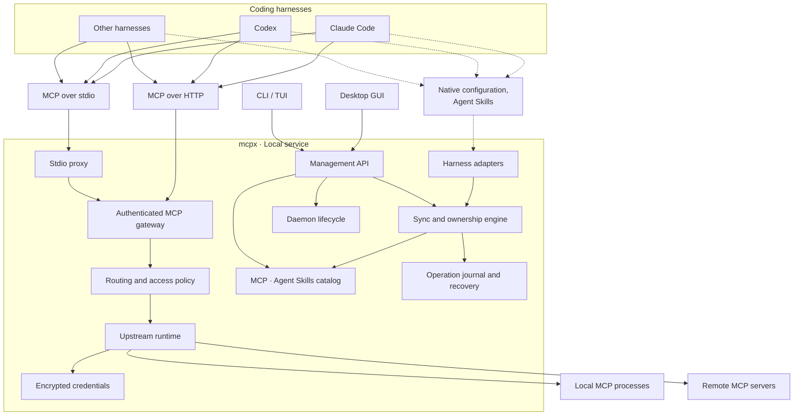

# mcpx

<p align="center">
  
</p>

<p align="center">
  <b>mcpx</b> is a local MCP gateway. Install upstream MCP servers once, authorize them once, and expose them to multiple AI clients — all managed from a native desktop app (macOS + Linux + Windows) or CLI.
</p>


## Platforms

- **macOS** — Desktop app (menubar tray) + CLI
- **Linux** — Desktop app (system tray) + CLI
- **Windows** — Desktop app (system tray) + CLI
- **CLI only**: Any platform with Node.js >= 20 or Bun >= 1.4.0

## Desktop App

The mcpx desktop app is the easiest way to manage your MCP servers. It runs in your system tray with a full dashboard for server discovery, configuration, and monitoring.

- **Tray** — Gateway status, a quick server list, and one-click dashboard access
- **Dashboard** — Start/stop the gateway daemon, view connected servers, and add new ones with a paste-and-go command input
- **Browse Registry** — Discover and one-click install servers from the official MCP Registry
- **Projects** — Organize servers into project-specific groups
- **Skills** — Create and manage shared MCP skill definitions
- **Settings** — Configure auto-start, launch-at-login, auto-updates, and whether secrets use the OS keychain
- **Privacy & diagnostics** — Independently control anonymous usage analytics
  and crash diagnostics, reset the random installation ID, and review the
  complete [privacy policy](PRIVACY.md)

### Download

Download the latest release from [GitHub Releases](https://github.com/kwonye/mcpx/releases).

### Install from source

Prerequisites: [Bun](https://bun.sh) >= 1.4.0

**macOS:**
```bash
git clone https://github.com/kwonye/mcpx.git
cd mcpx/cli
bun install
cd ../app
bun install
bun run desktop-install
```

This builds and installs the app to `/Applications/mcpx.app`.

For development with DevTools:
```bash
bun run desktop-install:dev
```

**Linux:**
```bash
git clone https://github.com/kwonye/mcpx.git
cd mcpx/cli
bun install
bun run build
cd ../app
bun install
bun run build
bunx electron-builder build --linux
```

This produces an AppImage and `.deb` in `app/dist/`. The package copies `cli/dist` and starts that CLI as the gateway, so build the CLI before `electron-builder`.

**Windows:**
```bash
git clone https://github.com/kwonye/mcpx.git
cd mcpx/cli
bun install
bun run build
cd ../app
bun install
bun run build
bunx electron-builder build --win
```

This produces an NSIS installer and portable `.exe` in `app/dist/`. Build `cli/dist` first, the same way as on Linux. The macOS `desktop-install` script builds the CLI for you.

### Quick Tour

**Tray & popover** — On macOS the tray icon is green while the gateway is running and red while it is stopped. Linux and Windows use one tray icon; the tooltip says whether the gateway is running. Click the icon to open a quick-status popover:


- **Start / Stop** the gateway daemon
- See active server count at a glance
- **Add Your First Server** — Paste any `mcpx add` command directly into the popover
- **Open Dashboard** — Jump to the full management window

**My Servers tab** — The main view for managing your MCP servers:


- See all configured upstream servers and their connection status
- Start/stop the gateway daemon
- Add servers by pasting an `mcpx add` command (e.g. `mcpx add vercel https://mcp.vercel.com/mcp`)

**Browse Registry tab** — Discover and install MCP servers from the official registry:


- Browse curated MCP servers
- One-click install

**Projects tab** — Organize servers into project groups:


**Skills tab** — Manage shared skill definitions:


Skills are stored as complete Agent Skill directories (`SKILL.md`, optional
`scripts/`, `references/`, and `assets/`). Clients receive complete directory projections, linked to the managed source when
supported. Installed skills are immutable until copied with `mcpx skill
customize`.

**Settings tab** — App configuration:


---

## CLI

The `mcpx` CLI is also available as a standalone npm package for terminal workflows and CI.

### Privacy and diagnostics

mcpx keeps analytics dormant until its first-run disclosure is acknowledged.
Usage analytics and crash diagnostics are independently controllable, and both
are anonymous by design. Review or change them with:

```bash
mcpx telemetry status
mcpx telemetry enable usage|errors|all
mcpx telemetry disable usage|errors|all
mcpx telemetry reset-id
```

See [PRIVACY.md](PRIVACY.md) for the exact event catalog, prohibited data, and
native minidump warning. Maintainers can follow the [observability runbook](docs/observability.md)
to configure provider projects, alerts, and release source maps.

### Install

```bash
npm install -g @kwonye/mcpx@latest
# or
bun add -g @kwonye/mcpx@latest
```

### Quick Start

#### Add servers with CLI (recommended)

```bash
mcpx add vercel https://mcp.vercel.com/mcp
mcpx add next-devtools npx next-devtools-mcp@latest
```

`mcpx add` and `mcpx remove` auto-sync by default. Run `mcpx sync` when you want a manual re-sync or to target specific clients.

Sync defaults to detected harnesses and installations explicitly enrolled in mcpx.
Use `mcpx sync <client>` to configure a specific installation. Observe-only
installations are left untouched, including when explicitly targeted.
CLI, desktop, plugin operations, and OAuth completion use the same locked sync
transaction. See [architecture](docs/architecture.md) for ownership and credential boundaries.

#### Client-native compatibility shims

```bash
# Claude Code
mcpx claude mcp add vercel https://mcp.vercel.com/mcp

# Codex
mcpx codex mcp add next-devtools --env FOO=bar -- npx next-devtools-mcp@latest

# VS Code
mcpx code --add-mcp '{"name":"vercel","url":"https://mcp.vercel.com/mcp"}'
```

#### Add servers manually in JSON config

Edit `~/.config/mcpx/config.json` and add entries under `servers`:

```json
{
  "servers": {
    "vercel": {
      "transport": "http",
      "url": "https://mcp.vercel.com/mcp",
      "headers": {
        "Authorization": "secret://vercel_auth_header"
      }
    },
    "next-devtools": {
      "transport": "stdio",
      "command": "npx",
      "args": ["next-devtools-mcp@latest"],
      "env": { "FOO": "bar" },
      "cwd": "/path/to/project"
    }
  }
}
```

After manual edits, run `mcpx sync` to propagate changes.

---

## What it does

- Stores upstream servers in a central config (`~/.config/mcpx/config.json`)
- Stores upstream auth in one shared secret store (an AES-256-GCM file by default, or an opt-in OS keychain) so each MCP auth flow is done once and reused across all synced clients
- Runs a local MCP gateway daemon (`http://127.0.0.1:<port>/mcp`)
- Syncs managed gateway entries into supported clients:
  - Claude Code
  - Claude Desktop
  - Codex
  - Cursor
  - Cline
  - OpenCode
  - Kiro
  - VS Code
  - Qwen Code
  - OpenClaw
  - Hermes
  - Pi
- Gives each upstream a top-level client entry (`/vercel`, `/next-devtools`, etc.) while routing through one local daemon
- Uses local gateway-token auth for client → gateway (`x-mcpx-local-token`)
- Supports secret references for upstream headers and stdio environment variables. The default file store needs no keychain prompts; `mcpx secret backend keychain` opts into the OS keychain on macOS and Linux
- Passes upstream OAuth challenges through to compatible clients
- Proxies OAuth well-known metadata endpoints in single-upstream mode

### MCP protocol support

mcpx supports MCP v2 only, pinned to protocol revision `2026-07-28`. The local
`/mcp` endpoint accepts modern MCP v2 envelopes and rejects legacy initialize,
session, batch, and legacy HTTP+SSE transport traffic. Client configuration adapters remain available
for projecting the v2 gateway into supported client config formats; they do not
add legacy protocol support.

---

## Advanced CLI Usage

### Auth and secrets

```bash
mcpx secret set vercel_auth_header --value "Bearer <token>"
mcpx secret ls
mcpx secret rm vercel_auth_header
mcpx secret backend                 # show file (default) or keychain
mcpx secret backend keychain        # move secrets into the OS keychain
mcpx secret backend file            # move secrets back to the encrypted file

mcpx auth set vercel --header Authorization --value "Bearer <token>"
mcpx auth set next-devtools --env NEXT_DEVTOOLS_TOKEN --value "<token>"
mcpx auth show
mcpx auth rm vercel --header Authorization --delete-secret
mcpx auth rotate-local-token

# OAuth
mcpx auth login vercel     # browser sign-in for an HTTP upstream that supports OAuth
mcpx auth status           # sign-in state, token expiry, secret-binding status, and the active secret backend (offline)
mcpx auth logout vercel    # clear stored OAuth credentials and the Authorization binding
```

### Daemon lifecycle

```bash
mcpx daemon start
mcpx daemon status
mcpx daemon restart
mcpx daemon logs
mcpx daemon stop
```

The gateway listens on `http://127.0.0.1:<port>/mcp`. The configured port defaults to `37373`. If that port is busy, startup tries the next 20 ports, saves the one it binds, and re-syncs clients that already have a sync record. `mcpx daemon logs` prints the last 200 lines (`--lines` changes that). The log file is `daemon.log` in the state directory and rotates at 10 MB, keeping `daemon.log.1` and `daemon.log.2`.

### Targeted sync

```bash
mcpx sync
mcpx sync claude
mcpx sync --client claude --client codex
```

### Local gateway control

The desktop Control Center and management CLI share the local control service.
See the [gateway architecture guide](docs/local-gateway.md) for its control
endpoint, adoption and recovery behavior.

```bash
mcpx tui
mcpx harnesses --json
mcpx adopt --dry-run
mcpx adopt --yes
mcpx harness-mode pi automatic
mcpx activity
mcpx package list
mcpx undo <operation-id>
```

### Open AI development standards

mcpx exclusively uses [Agent Skills](https://agentskills.io/specification),
[MCP revision 2026-07-28](https://modelcontextprotocol.io/specification/2026-07-28),
[AGENTS.md](https://agents.md/), and the official
[MCP Apps](https://apps.extensions.modelcontextprotocol.io/api/) and
[Skills over MCP](https://modelcontextprotocol.io/extensions/skills/overview) extensions.
Claude, Codex, Cursor, and custom marketplace catalogs distribute plugins containing
standard Agent Skills and MCP servers. Hooks, slash commands, subagent definitions,
and native package loaders remain unsupported; plugin inspection identifies those components.

```bash
mcpx skill install ./review
mcpx skill install owner/skills --skill review
mcpx project instructions ./cli/src --root .
```

Skills must contain valid YAML frontmatter with a name matching the skill directory.
All supporting files are preserved. AGENTS.md files are read from the project root
to the target directory; the nearest file takes precedence where instructions conflict.
See [standards and migration](docs/standards.md) for compatibility details.

### Plugin marketplaces and management

The Library includes Discover, Installed, Marketplaces, and Shared Skills views.
Claude official (`anthropics/claude-plugins-official`), Codex official (`openai/plugins`),
and Cursor official (`cursor/plugins`) are configured by default. Add custom catalogs
from a local directory or JSON file, Git repository, GitHub shorthand, or hosted JSON URL.

```bash
mcpx plugin marketplace list
mcpx plugin marketplace add team/plugins
mcpx plugin marketplace add ./team-catalog --manifest catalogs/team.json
mcpx plugin browse --marketplace team-tools
mcpx plugin details reviewer@team-tools
mcpx plugin install reviewer@team-tools --yes
mcpx plugin disable reviewer
mcpx plugin enable reviewer
mcpx plugin pin reviewer
mcpx plugin unpin reviewer
mcpx plugin marketplace update team-tools
mcpx plugin rollback reviewer
mcpx plugin uninstall reviewer --keep-data
mcpx plugin marketplace remove team-tools --yes
```

Inspect a plugin's supported and unsupported components before installation. Updates
can be requested individually or by refreshing its marketplace. Pinning holds the
installed revision; rollback restores the previous cached revision. Automatic updates
are opt-in for new marketplaces. Custom marketplace removal uninstalls its plugins
while retaining plugin data. Default marketplaces cannot be replaced or removed.

### Portable environments

Export a Git-friendly folder containing a manifest, lockfile, and package
content. Credentials are represented as recipient inputs or secret references;
they are never copied into the export by default.

```bash
mcpx share export ./shared-environment
mcpx share import ./shared-environment --dry-run --locked
mcpx share import ./shared-environment --locked --input server.docs.header.X-Team=team-a
```

### Config, data, and state

mcpx uses the same directory layout on every platform, under the user profile. On Windows that is `%USERPROFILE%`, not `%APPDATA%` (some synced clients, such as VS Code, still use their own native paths).

| | Default | Override |
| --- | --- | --- |
| Config | `~/.config/mcpx/config.json` | `MCPX_CONFIG_HOME`, else `XDG_CONFIG_HOME` |
| Data | `~/.local/share/mcpx/` (`secrets.json`, `secrets.key`, managed index) | `MCPX_DATA_HOME`, else `XDG_DATA_HOME` |
| State | `~/.local/state/mcpx/` (`runtime/daemon.pid`, `logs/daemon.log`) | `MCPX_STATE_HOME`, else `XDG_STATE_HOME` |

Each override replaces the root (`~/.config`, `~/.local/share`, or `~/.local/state`). `mcpx doctor` prints the config path and the active secrets store.

### Troubleshooting

```bash
mcpx doctor
mcpx status
mcpx status --no-interactive
mcpx clients list
mcpx daemon logs
mcpx sync --json
```

In a terminal, `mcpx status` opens the same control center as `mcpx tui`. `mcpx status --no-interactive` (or any non-TTY session) prints the gateway URL, daemon state, upstreams, and client sync states. `mcpx status --json` prints that report as JSON. `mcpx clients list` prints each supported client and the config path it detected.

On macOS, startup asks the login shell for `PATH` and continues after two seconds if that shell does not exit. The tray still appears, and the app keeps the `PATH` it already had. Packaged builds load tray icons from the unpacked app resources.

---

## Build and test from source

### CLI

```bash
cd cli
bun install
bun run build
bun test
```

### Desktop app

```bash
cd app
bun install
bun run dev      # Start Electron dev server
bun run build     # Build for production
bun run test      # Run unit tests
bun run e2e       # Run Playwright E2E tests
```

---

## Architecture

This is a monorepo containing:

- **`cli/`** — The `mcpx` CLI and core library (`@kwonye/mcpx`)
- **`app/`** — The desktop app (Electron + React) for macOS, Linux, and Windows

The desktop app imports the CLI's core logic directly via a `@mcpx/core` TypeScript alias, so both packages share identical configuration parsing, sync logic, and secret management.

The target architecture consolidates MCP traffic and standard Agent Skills through one local service:



Claude Desktop uses the stdio proxy to reach the local mcpx gateway. Its [remote HTTP connectors](https://support.claude.com/en/articles/11175166-get-started-with-custom-connectors-using-remote-mcp) connect from Anthropic's cloud and require a publicly reachable server; they cannot connect directly to mcpx on localhost.

## Secrets

mcpx keeps upstream credentials out of client config files. The active backend is `secrets.backend` in `config.json`: `file` (the default) or `keychain`. The CLI and the desktop app share that setting.

`MCPX_SECRET_<name>` overrides the stored value for that name on every backend, and it is applied before the store is read. That covers CI and other headless sessions, and it still works when the keychain cannot be unlocked.

### Encrypted file (default)

`secrets.json` and `secrets.key` live in the data directory (`~/.local/share/mcpx` unless `MCPX_DATA_HOME` or `XDG_DATA_HOME` is set). Node's built-in `crypto` encrypts the file with AES-256-GCM, so there is no native dependency and no system prompt. The encryption key sits on disk beside the ciphertext: any program running as your user can read both files and decrypt the secrets.

### OS keychain (opt-in)

```bash
mcpx secret backend                 # print the active backend and the tradeoff
mcpx secret backend keychain        # opt in and migrate stored secrets
mcpx secret backend file            # move secrets back to the encrypted file
```

Running the command for the backend that is already active changes nothing.

**Platforms.** macOS uses the login Keychain through the built-in `security` command. Linux uses libsecret through `secret-tool`. Install `libsecret-tools` (Debian/Ubuntu) or `libsecret` (Fedora). If that command is missing, the switch fails and the active backend is left unchanged. Windows and every other platform reject `keychain`. Opting in fails and the file backend stays active. A config that is already set to `keychain` cannot be read or switched there; switch back to `file` on macOS or Linux first. `MCPX_SECRET_<name>` still supplies a value without reading the keychain. The desktop Settings toggle calls the same switch; a failed change reverts the toggle and shows the error.

**What is stored.** One item holds the whole secret map. In Keychain Access it is labeled `mcpx secrets` (service `com.kwonye.mcpx`, account `secrets`). Linux uses the same service and account. Values are written on the tool's standard input, not as process arguments, so other processes cannot see them in the process list. On macOS that write is `security -i`. One interactive command is at most 4094 bytes. A larger vault is split across `secrets.1`, `secrets.2`, and so on (at most 256 items) and joined again on read; the `secrets` item then records only how many pieces to join. A vault that still does not fit is rejected. Linux stores a single item and does not split it. An older single-item macOS entry still reads.

**Switching.** The copy you are leaving is merged onto the destination. A name that exists only on the destination is kept. The same name in both stores keeps the value from the source. mcpx reads the new copy back before it records `secrets.backend`, then deletes the previous copy (`secrets.json` and `secrets.key`, or the keychain items). If the write or the read-back fails, the active backend and the source copy stay as they were, and the previous destination copy is restored. If the new backend is already recorded but the old copy cannot be deleted, the command fails and says so; both copies still exist until that delete succeeds.

**Prompts and failures.** The operating system protects the item and may prompt for access. A locked session or a missing secret service cannot unlock it. The process that is reading or writing the keychain waits while that prompt is open. A command that changes secrets waits up to two minutes if another change still holds that prompt, then reports a timeout. An unreadable file vault or keychain payload is not overwritten. Restore the matching `secrets.key`, or the previous keychain item, before retrying.

`mcpx secret ls` prints `backend: file` or `backend: keychain` and the secret names, not the values. `mcpx auth status` prints `Secret backend: …`; `--json` includes `secretBackend`. `mcpx doctor` reports `secrets_store` as `keychain` or `file (<path>)`.

## Notes

- Client connectivity is HTTP-first; upstreams can be HTTP or stdio
- Secret storage is described in [Secrets](#secrets). `MCPX_SECRET_<name>` overrides the stored value on every backend
